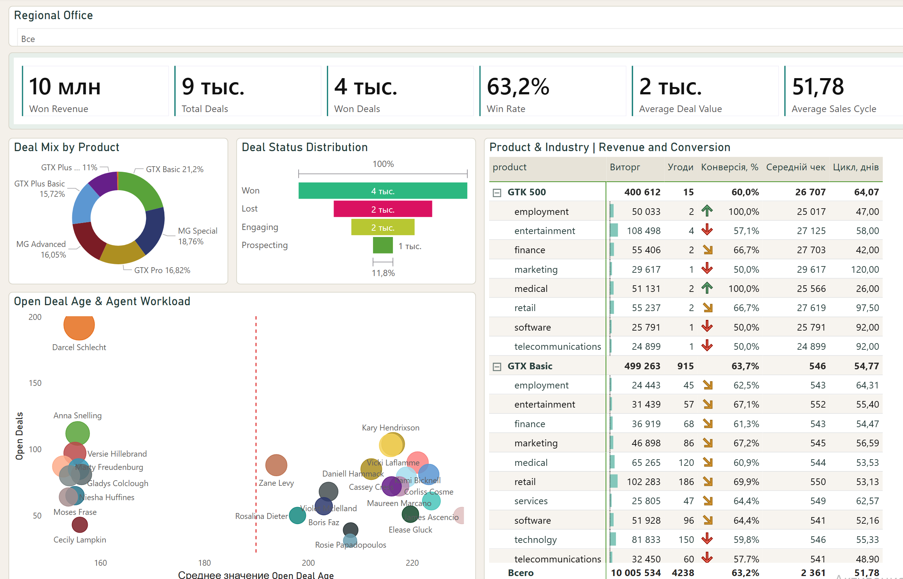
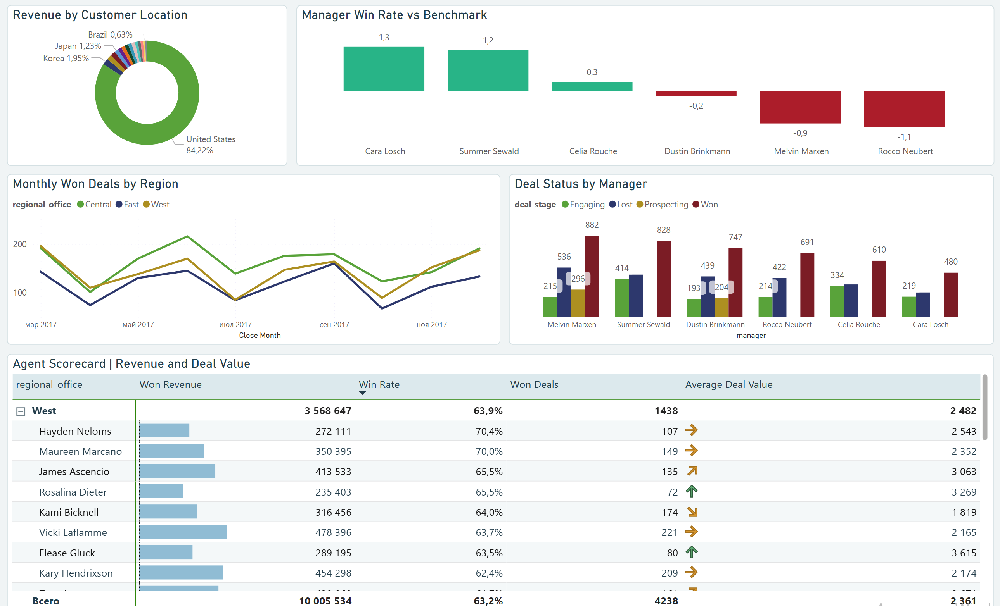
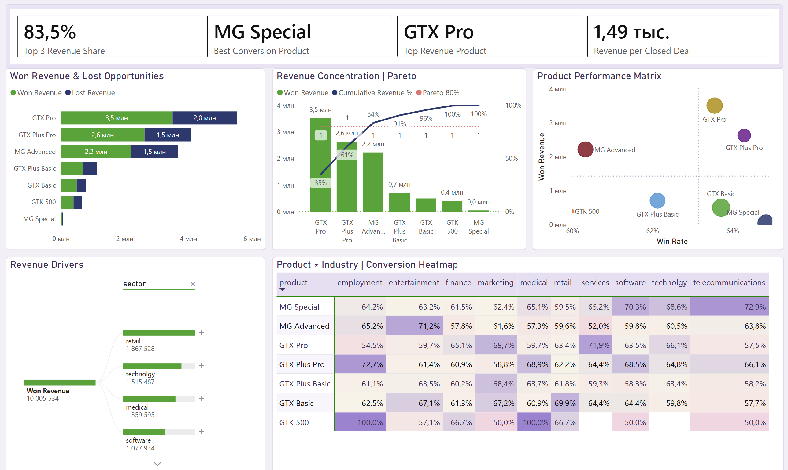

# Power BI | Sales Performance Analytics

## Про проєкт

Інтерактивний аналітичний дашборд, розроблений у Microsoft Power BI для комплексного аналізу ефективності продажів, результативності команд, конверсії угод та продуктового портфеля компанії.

Мета проєкту — виявлення закономірностей у процесах продажів, оцінка ефективності менеджерів, визначення найбільш результативних продуктів та пошук потенційних напрямів зростання бізнесу.

## 01 | Sales Overview

Загальний аналіз бізнес-показників та результативності продажів:

- Ключові показники ефективності (KPI).
- Динаміка виторгу та кількості угод.
- Аналіз статусів угод.
- Конверсія успішних угод (Win Rate).
- Середня вартість угоди.
- Порівняльний аналіз продуктів і клієнтських сегментів.
- Аналітична матриця з індикаторами та смужками даних.

## 02 | Sales Team

Комплексний аналіз ефективності команд та менеджерів:

- Результативність регіональних офісів.
- Порівняння менеджерів за виторгом та конверсією.
- Аналіз кількості успішних угод.
- Динаміка результатів продажів.
- Середня вартість угоди за менеджерами.
- Інтерактивна Agent Scorecard.
- Умовне форматування, кольорові стрілки та індикатори ефективності.

## 03 | Product Performance

Аналіз результативності продуктового портфеля:

- Виторг від успішних угод та потенційна вартість втрачених угод.
- Аналіз концентрації виторгу за принципом Парето (80/20).
- Кумулятивна частка виторгу.
- Багатофакторна матриця ефективності продуктів.
- Взаємозв'язок конверсії, виторгу та кількості угод.
- Дерево декомпозиції показників.
- Теплова карта конверсії за продуктами та галузями.

## Аналітичні методи

- Sales Performance Analysis
- Conversion Analysis
- KPI Analysis
- Pareto Analysis
- Revenue Concentration Analysis
- Sales Team Benchmarking
- Product Portfolio Analysis
- Comparative Analysis
- Data Visualization
- Conditional Formatting

## Технології

- Microsoft Power BI
- DAX
- Power Query
- Data Modeling
- Time Intelligence
- Business Intelligence

## Особливості реалізації

- Інтерактивні візуалізації та фільтрація.
- Розрахункові DAX-міри.
- Ієрархічна деталізація показників.
- Умовне форматування матриць.
- Кольорові градієнти, стрілки та смужки даних.
- Індивідуальне оформлення аналітичних сторінок.

## Завантажити дашборд

[Завантажити Power BI (.pbix)](Sales_Performance_Editorial_Scorecard.pbix)

Для роботи з інтерактивним звітом необхідно завантажити файл та відкрити його в Microsoft Power BI Desktop.

## Портфоліо

[Переглянути всі мої Power BI проєкти](https://github.com/Litcheveckiy3477/power-bi-portfolio)
