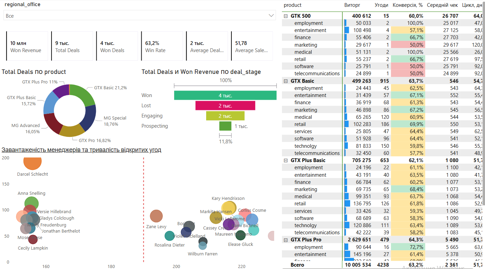
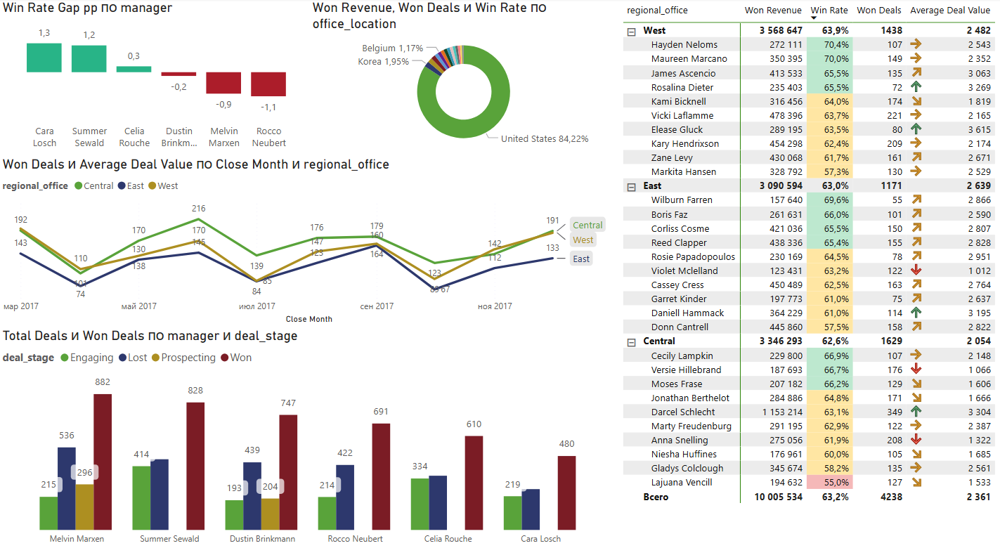
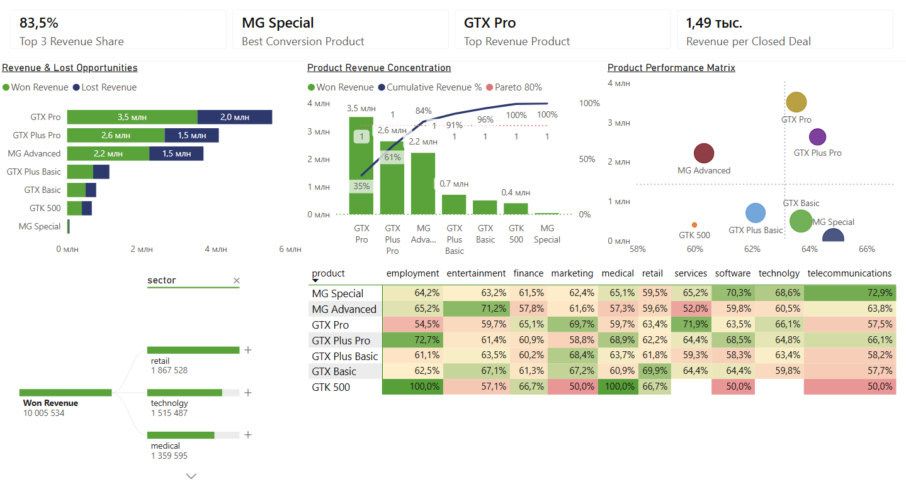

# Power BI | Аналіз ефективності продажів

## Про проєкт

Інтерактивний аналітичний дашборд, розроблений у Microsoft Power BI для комплексного аналізу ефективності продажів, результативності команд, конверсії угод та продуктового портфеля компанії.

Основна мета проєкту — виявлення факторів, що впливають на результати продажів, пошук потенціалу зростання та формування аналітичної основи для прийняття управлінських рішень.

## Структура дашборду

### 01 | Sales Overview

Загальний аналіз продажів та основних бізнес-показників:

- Динаміка доходу та кількості угод.
- Аналіз воронки продажів.
- Конверсія успішних угод (Win Rate).
- Розподіл продажів за продуктами.
- Ефективність та завантаженість менеджерів.

### 02 | Sales Team

Аналіз результативності команд та окремих менеджерів:

- Порівняння ефективності регіональних команд.
- Аналіз результативності керівників та менеджерів.
- Динаміка успішних угод.
- Відхилення конверсії від загального показника компанії.
- Виявлення найбільш та найменш результативних напрямів.

### 03 | Product Performance

Комплексний аналіз ефективності продуктового портфеля:

- Порівняння фактичного доходу та потенційної вартості програних угод.
- Діаграма Парето — аналіз концентрації доходу.
- Матриця ефективності продуктів за доходом та конверсією.
- Теплова карта конверсії продуктів у розрізі галузей клієнтів.
- Інтерактивне дерево декомпозиції доходу.
- Аналіз потенціалу масштабування продажів.

## Основні аналітичні показники

| Показник | Опис |
|---|---|
| Won Revenue | Дохід від успішних угод |
| Total Deals | Загальна кількість угод |
| Won Deals | Кількість успішних угод |
| Lost Deals | Кількість програних угод |
| Win Rate | Частка успішних угод серед закритих |
| Average Deal Value | Середня вартість угоди |
| Average Sales Cycle | Середня тривалість циклу продажу |
| Lost Revenue | Оцінка потенційної вартості програних угод |
| Cumulative Revenue % | Накопичувальна частка доходу |

## Основні аналітичні висновки

- Три основні продукти формують приблизно 84% загального доходу, що свідчить про високу концентрацію продажів.
- GTX Pro є лідером за доходом, водночас має значний обсяг нереалізованих можливостей.
- MG Advanced формує значну частку доходу, проте має потенціал для підвищення конверсії.
- MG Special характеризується відносно високою конверсією при низькому обсязі доходу.
- Ефективність продажу окремих продуктів суттєво відрізняється залежно від галузі клієнта.

## Підготовка та моделювання даних

У межах проєкту виконано:

- Очищення та трансформацію даних у Power Query.
- Перевірку відповідності назв продуктів між таблицями.
- Побудову зв'язків між таблицями продажів, продуктів, клієнтів та команд.
- Розробку розрахункових показників за допомогою DAX.
- Налаштування умовного форматування та динамічних аналітичних показників.
- Побудову інтерактивних візуалізацій.

## Використані технології

- Microsoft Power BI Desktop
- DAX
- Power Query (M)
- Data Modeling
- Data Visualization
- Business Intelligence
- Exploratory Data Analysis

## Методи аналізу

- KPI Analysis
- Sales Funnel Analysis
- Conversion Analysis
- Pareto Analysis
- Product Performance Analysis
- Decomposition Analysis
- Comparative Analysis

## Особливості методології

Win Rate розраховується на основі закритих угод без урахування незавершених.

Потенційна вартість програних угод оцінюється на основі довідникових цін продуктів та не є фактичним фінансовим збитком компанії.

## Файл проєкту

[Завантажити Power BI Dashboard (.pbix)](Sales_Performance_Dashboard.pbix)

Для перегляду інтерактивного дашборду необхідно відкрити файл у Microsoft Power BI Desktop.

---

Проєкт створено в межах розвитку практичних навичок бізнес-аналітики, аналізу даних та Business Intelligence.
